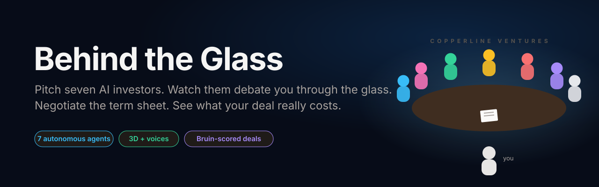
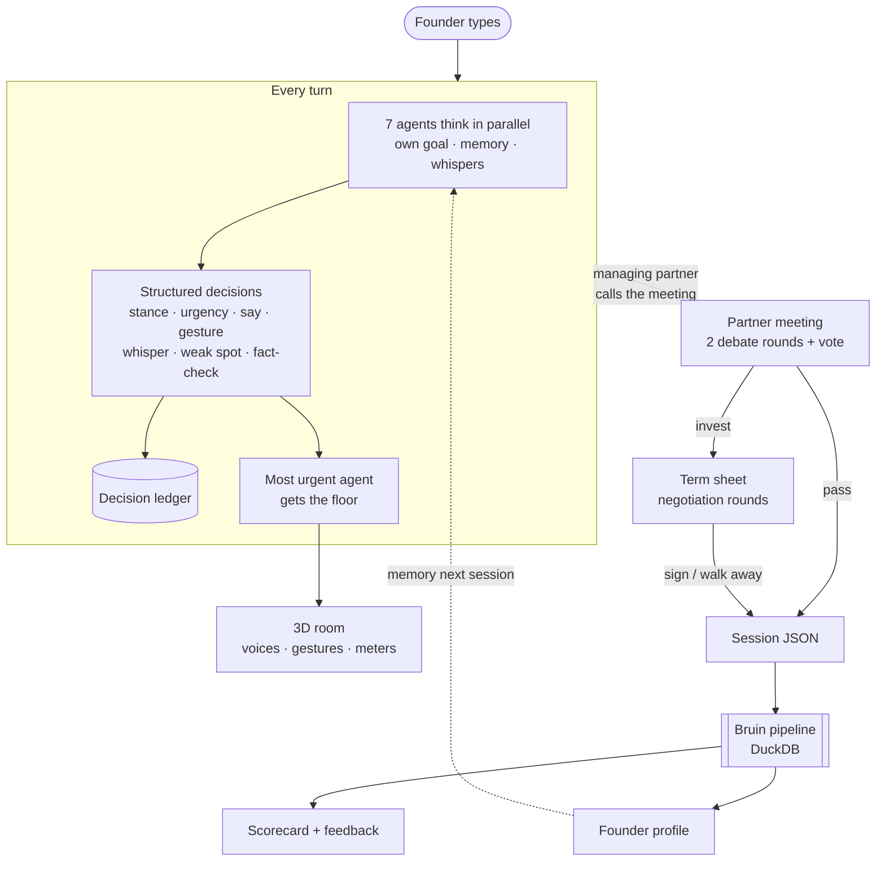
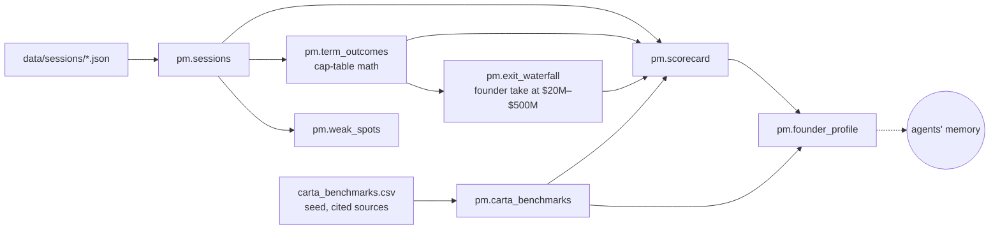
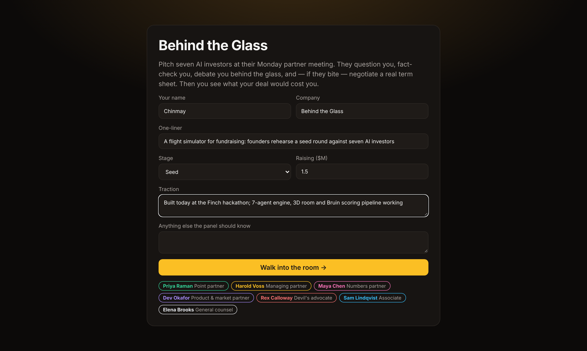

<p align="center">
  
</p>

<p align="center">
  
  
  
  
  
  
</p>

<p align="center"><b>A flight simulator for fundraising.</b><br/>
Pitch seven AI investors at their Monday partner meeting. They question you, fact-check you live, debate you behind the glass and vote.
If they bite, you negotiate a real term sheet. Then a Bruin pipeline prices your deal against real market data — and the panel remembers you next time.</p>

---

## The problem

- **Every bad pitch burns a real investor.** Founders typically need **100–200 investor conversations** to close a seed round ([Techstars](https://www.techstars.com/blog/founder-advice/the-founders-guide-to-fundraising-rejection)); one VC saw **11 checks from ~4,500 decks** ([Carta](https://carta.com/data/linkedin-pitch-deck-to-funding-rate-vc/)).
- **Founders lose the most in the fine print.** First-time founders often don't grasp liquidation preferences and over-focus on valuation ([SVB](https://www.svb.com/startup-insights/raising-capital/read-startup-term-sheet/)); losing board control means you can be fired from your own company ([YC](https://www.ycombinator.com/blog/a-standard-and-clean-series-a-term-sheet/)).
- **Practice tools stop at the pitch.** Existing AI pitch coaches are one AI giving a score. None show what investors say after you leave the room, and none negotiate the deal with you.

## What it does

| | |
|---|---|
| **🎤 Pitch & Q&A** | Type your pitch. Seven investors think in parallel; the most urgent ones interrupt, out loud, each with their own voice. Opinion meters over their heads move as you talk. |
| **🔎 Live fact-checks** | The associate checks your claims on the web and whispers what he found to the devil's advocate. |
| **🪟 Behind the glass** | The managing partner sends you out. The partners walk to the corner, argue for two rounds and vote — you watch it all. |
| **📝 Term sheet** | The managing partner sets terms from the debate: valuation, liquidation preference, participation, option pool, board, pro rata, clauses. Negotiate; the partners whisper strategy and concede or hold. |
| **📊 Debrief** | Bruin scores your deal: dilution vs the Carta seed median, what the terms cost you at a $100M exit, what you won in negotiation, plus feedback that quotes your own words. |
| **🧠 Memory** | Come back with the same name and the panel opens with your old weak spots. |

<p align="center">
  
</p>

## The seven agents

Each investor is its own Claude agent with a **private goal**. Every turn, each one independently decides what it thinks, how far its opinion moves, whether to speak, who to whisper to, how to gesture, which weak spot to log, and (associate) what to fact-check. The orchestrator only hands the floor to whoever wants it most — it never writes their lines. Every decision lands in the **decision ledger**.

| | Agent | Role | Private goal |
|---|---|---|---|
| 🟢 | Priya Raman | Point partner | Brought you in; wants the deal, won't defend dodged answers |
| 🟡 | Harold Voss | Managing partner | Final say, protects the fund, calls the partner meeting |
| 🩷 | Maya Chen | Numbers partner | Real metrics; pushes valuation to what they support |
| 🟣 | Dev Okafor | Product & market | Why now, competitors, moat |
| 🔴 | Rex Calloway | Devil's advocate | Find the reason to say no |
| 🔵 | Sam Lindqvist | Associate | Fact-checks your claims on the web, whispers findings |
| ⚪ | Elena Brooks | General counsel | Protects the firm in the fine print; joins for the term sheet |

The cast mirrors real partner meetings: a sponsoring partner, the full partnership, an associate who did the diligence and counsel ([First Round Review](https://review.firstround.com/heres-what-you-can-really-expect-when-pitching-your-seed-stage-startup-at-a-vc-behind-the-glass/)).

## How it works



### Bruin pipeline



Assets carry Bruin quality checks (`not_null`, `unique`, `accepted_values`, `non_negative`). Benchmarks used: 2026 median seed valuation ~$19.7M ([Carta Q3 2026](https://carta.com/data/state-of-private-markets-q3-2026-full-report/)), seed dilution ~19% ([Carta 2025](https://www.carta.com/data/state-of-private-markets-q4-2025)), clean terms = 1x non-participating ([YC](https://www.ycombinator.com/blog/a-standard-and-clean-series-a-term-sheet/)).

## Quick start

You need Node 22+, the [Bruin CLI](https://getbruin.com) and an [Anthropic API key](https://console.anthropic.com). Chrome or Edge give the best voices. No microphone needed.

```bash
curl -LsSf https://getbruin.com/install/cli | sh
```

```bash
git clone https://github.com/ChinmayPatel07/finch-hack && cd finch-hack/app && npm install && cp .env.example .env
```

Add your key to `app/.env`, then:

```bash
npm run dev
```

Open **http://localhost:5173**, fill in your startup and walk into the room.

<p align="center">
  
</p>

## Built with

| Layer | Tech |
|---|---|
| Agents | Claude API — structured outputs (zod), server-side web search for fact-checks, refusal fallbacks |
| Server | Node 22, Express, Server-Sent Events |
| 3D | React, Three.js, React Three Fiber, drei |
| Voices | Browser speech synthesis, one voice per agent |
| Data | **Bruin** pipeline on DuckDB (seed + SQL assets + quality checks) |

## Hackathon checklist

| Requirement | How |
|---|---|
| Track 3: agents in expert roles as visible characters | Seven VC partners in a 3D room |
| 2–3+ agents coordinate about the human | Whispers, partner debate and vote, negotiation strategy |
| Agents adapt to how the human performs | Stances drive questions, the vote and the terms |
| Clear result with evidence-based feedback | Bruin scorecard vs Carta + feedback quoting the founder |
| ≥3 agents with own goals · characters that move · visible decisions | 7 agents with private goals · walking, gesturing avatars · live decision ledger |
| Bonus: 3D · voice · memory that changes decisions | All three |
| Bruin (mandatory) | Scores every session and stores the panel's memory |

## Repository

```
app/      React + Three.js frontend and the Node agent engine (see docs/ARCHITECTURE.md)
bruin/    Bruin pipeline: Carta seed, SQL assets, quality checks
docs/     Plan, research with sources, architecture, images
```

```bash
cd app && npm run typecheck && npm test && npm run build
```

Tests run offline: a whole session (pitch → partner meeting → term sheet → debrief) with a test double for the model, and every Bruin SQL asset on DuckDB against a fixture.

## What's next

- Upload a pitch deck and let the panel read it
- Pick a real fund's thesis to pitch against
- Series A mode (bigger panel, tougher terms)
- Sponsor integrations: Runware-generated partner portraits, BAND for the private partner channel, Telem for live web data

---

<sub>Built solo in one day at the Finch Multiplayer AI Hackathon, Nov 23 2026. Copperline Ventures and its partners are fictional. This is a practice tool, not legal or financial advice.</sub>
