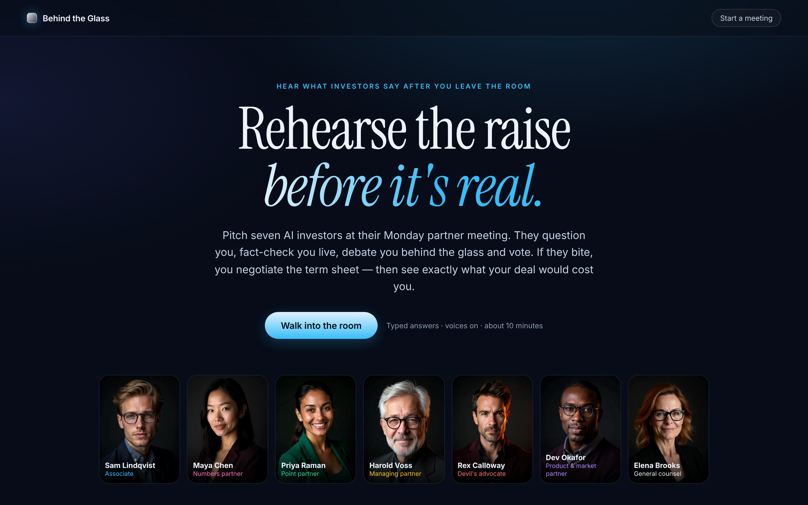
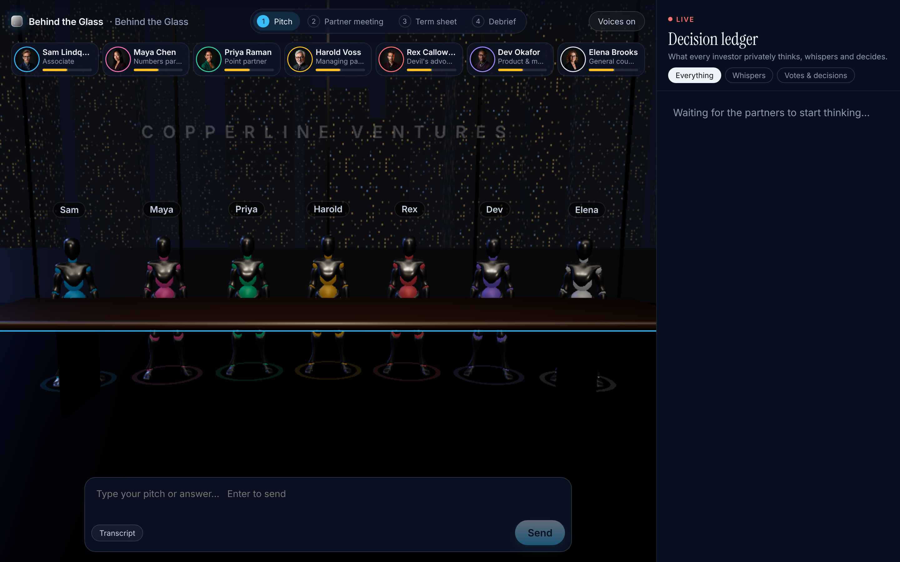
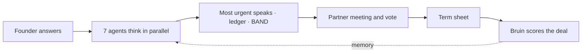

<p align="center">
  
</p>

<p align="center">
  <b>Hear what investors say after you leave the room.</b><br/>
  A practice partner meeting with seven AI investors who question you, fact-check you live, debate you behind the glass,
  vote, and negotiate a real term sheet — then a data pipeline prices the deal you got.
</p>

<p align="center">
  
  
  
  
  
</p>

<p align="center">
  <a href="#the-experience">The experience</a> ·
  <a href="#how-it-works">How it works</a> ·
  <a href="#sponsor-integrations">Sponsor integrations</a> ·
  <a href="#run-it-locally">Run it locally</a> ·
  <a href="docs/ARCHITECTURE.md">Architecture</a>
</p>

<p align="center">
  
</p>

## The problem

- **Every bad pitch burns a real investor.** Founders typically need 100–200 investor conversations to close a seed round ([Techstars](https://www.techstars.com/blog/founder-advice/the-founders-guide-to-fundraising-rejection)); one VC wrote 11 checks from about 4,500 decks ([Carta](https://carta.com/data/linkedin-pitch-deck-to-funding-rate-vc/)).
- **The most expensive mistakes happen in the fine print.** First-time founders often miss what liquidation preferences do and over-focus on valuation ([SVB](https://www.svb.com/startup-insights/raising-capital/read-startup-term-sheet/)); losing board control means you can be fired from your own company ([YC](https://www.ycombinator.com/blog/a-standard-and-clean-series-a-term-sheet/)).
- **Practice tools stop at the pitch.** None show what investors say after you leave, and none negotiate the deal.

## The experience

| Stage | What happens |
|---|---|
| **Diligence** | Before you speak, the associate pulls recent news on your market (Glasser). Every partner reads it. |
| **Pitch** | You type; seven investors think in parallel. The most urgent ones interrupt, out loud, each in their own voice. Opinion bars move as you talk. |
| **Fact-check** | Checkable claims are verified live on the web (Telem) and whispered, with sources, to the devil's advocate. |
| **Behind the glass** | The managing partner sends you out. The partners walk to the corner, argue over two rounds and vote. Their private channel streams into a live BAND room. |
| **Term sheet** | If they invest, the managing partner sets terms from the debate — valuation, liquidation preference, participation, option pool, board, pro rata — and you negotiate. |
| **Debrief** | The Bruin pipeline scores the deal against Carta benchmarks, runs a 5,000-exit Monte Carlo, and every partner gives feedback that quotes your own words. |
| **Memory** | Come back under the same name and the panel opens with your old weak spots. |

<p align="center">
  
</p>

## The seven agents

Each investor is a separate Claude agent with a private goal, deciding for itself every turn. Every decision is shown in the live **decision ledger**.

| Agent | Role | Private goal |
|---|---|---|
| Priya Raman | Point partner | Brought you in; wants the deal but won't defend dodged answers |
| Harold Voss | Managing partner | Final say; protects the fund; calls the partner meeting |
| Maya Chen | Numbers partner | Real metrics; pushes valuation to what they support |
| Dev Okafor | Product and market partner | Why now, competitors, moat |
| Rex Calloway | Devil's advocate | Finds the reason to say no |
| Sam Lindqvist | Associate | Diligence and live fact-checks; whispers what he finds |
| Elena Brooks | General counsel | Protects the firm in the fine print; joins for the term sheet |

## How it works



Each turn, every agent returns a structured decision (opinion, urgency, line, whisper, gesture, weak spot, fact-check); the orchestrator only hands the floor to the most urgent. The Bruin pipeline (SQL and a Python Monte Carlo on DuckDB) turns each session into a scorecard and a founder profile the agents read next time. Full diagrams: [docs/ARCHITECTURE.md](docs/ARCHITECTURE.md).

## Sponsor integrations

| Sponsor | What it does in the product | Where |
|---|---|---|
| **Bruin** | Scores every session (SQL and Python assets with quality checks) and stores the panel's memory of each founder | [`bruin/`](bruin), [`app/server/bruin.ts`](app/server/bruin.ts) |
| **Telem** | Live web search behind every fact-check (Exa and Brave in one call, merged), cited in the ledger | [`app/server/llm.ts`](app/server/llm.ts) |
| **Runware** | The seven photoreal investor portraits and their seven voices (Inworld TTS through Runware) | [`app/scripts/generate-portraits.ts`](app/scripts/generate-portraits.ts), [`app/server/tts.ts`](app/server/tts.ts) |
| **Glasser** | The associate's pre-meeting diligence: recent news in the founder's market, read by every investor | [`app/server/sponsors.ts`](app/server/sponsors.ts) |
| **BAND** | The firm's BAND agent opens a room, invites its owner, and posts every whisper, fact-check, vote and decision as it happens | [`app/server/sponsors.ts`](app/server/sponsors.ts) |
| **AdaL** | Demo video editing | — |

Each integration switches on when its key is present. Built with Claude (structured outputs), Node, React Three Fiber, and Bruin on DuckDB.

<details>
<summary><b>Hackathon requirements checklist</b></summary>

| Requirement | How it is met |
|---|---|
| Track 3: agents in expert roles as visible characters | Seven VC partners in a 3D room, with portraits and voices |
| Agents coordinate about the human | Whispers, a two-round partner debate and vote, negotiation strategy |
| Agents adapt to how the human performs | Opinions drive the questions, the vote and the terms |
| A clear result with evidence-based feedback | Scorecard against Carta benchmarks, Monte Carlo, feedback quoting the founder |
| At least three agents with their own goals | Seven, each with a private goal |
| Characters that move and act | Rigged, animated figures that gesture, lean in, and walk to the partner meeting |
| Visible decisions | The live decision ledger, mirrored to BAND |
| Bonus: 3D, voice, learning | 3D room, a natural voice per agent, memory across sessions that changes their decisions |
| Bruin (mandatory) | Scoring, simulation and memory pipeline |

</details>

## Run it locally

Requires Node 22+, the [Bruin CLI](https://getbruin.com) and an [Anthropic API key](https://console.anthropic.com). No microphone needed; answers are typed.

```bash
curl -LsSf https://getbruin.com/install/cli | sh
```

```bash
git clone https://github.com/ChinmayPatel07/behind-the-glass && cd behind-the-glass/app && npm install && cp .env.example .env
```

Add your keys to `app/.env`. Only `ANTHROPIC_API_KEY` is required; `TELEM_API_KEY`, `RUNWARE_API_KEY`, `GLASSER_API_KEY` and `BAND_API_KEY` each switch on their feature. Then:

```bash
npm run dev
```

Open http://localhost:5173.

<details>
<summary><b>Repository layout and tests</b></summary>

```
app/      Frontend (React, React Three Fiber) and the agent engine (Node)
bruin/    Bruin pipeline: Carta seed, SQL and Python assets, tests
docs/     Architecture and handoff, research with sources, plan, backlog, images
```

```bash
cd app && npm run typecheck && npm test && npm run build
```

```bash
python -m pytest bruin/tests
```

Tests run offline: a full session (pitch, partner meeting, term sheet, debrief) with a test double for the model, every Bruin SQL asset on DuckDB against a fixture, and the Monte Carlo asset. CI runs all of them. See [docs/ARCHITECTURE.md](docs/ARCHITECTURE.md) for how the engine, the 3D room and the pipeline fit together, and [docs/RESEARCH.md](docs/RESEARCH.md) for the research behind the product.

</details>

## What's next

Pitch-deck upload, pitching against a real fund's thesis, and a Series A mode with a larger panel.

## Team

Built solo by **[Chinmay Dharmesh Patel](https://github.com/ChinmayPatel07)** at the Finch Multiplayer AI Hackathon, November 23, 2026.

<sub>3D figure: the rigged "Xbot" model from the three.js examples (Mixamo animations). Copperline Ventures and its partners are fictional. Behind the Glass is a practice tool, not legal or financial advice.</sub>
