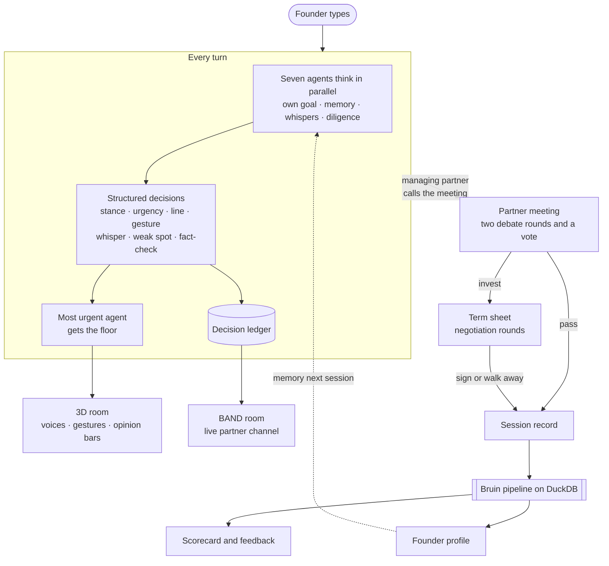
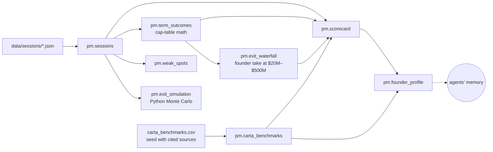

# Architecture and handoff

Start here to change or extend Behind the Glass.

## Diagrams

### Flow of a meeting



### The Bruin pipeline



SQL assets carry Bruin quality checks (`not_null`, `unique`, `accepted_values`, `non_negative`). `pm.exit_simulation` is a Python asset that samples 5,000 exits per term sheet and prices the founders' take under the actual terms and under clean terms — including how often the founders walk away with nothing. Benchmarks: 2026 median seed valuation about $19.7M ([Carta Q3 2026](https://carta.com/data/state-of-private-markets-q3-2026-full-report/)), seed dilution about 19% ([Carta 2025](https://www.carta.com/data/state-of-private-markets-q4-2025)), clean terms as 1x non-participating ([YC](https://www.ycombinator.com/blog/a-standard-and-clean-series-a-term-sheet/)).


## Layout

```
app/
  server/
    index.ts     Express API + Server-Sent Events; createApp(llm) for tests
    engine.ts    The meeting: phases, the seven agents' turns, huddle, negotiation, debrief
    agents.ts    The cast: names, roles, private goals, speaking style; shared room rules
    llm.ts       Claude calls: structured outputs (zod) and the associate's web-search fact-check
    bruin.ts     Writes session JSON, runs `bruin run`, reads scorecard / memory from DuckDB
  src/
    App.tsx      Setup screen, HUD, chat, term sheet card, ledger, debrief
    Room.tsx     The 3D room (React Three Fiber): avatars, gestures, walking, camera, term sheet
    voice.ts     Queue that reads each line aloud with one browser voice per agent
    cast.ts      Colours, looks and voice settings per agent
    shared/types.ts  Types shared by server and browser (events, terms, ledger)
  tests/         Offline tests (node:test): full session flow and Bruin SQL
bruin/
  .bruin.yml, pipeline.yml       DuckDB connection and pipeline
  assets/                         Seed (Carta benchmarks) + SQL assets with quality checks
  data/sessions/                  Session JSON written by the app (git-ignored)
docs/                             Plan, research, this file, README images
```

## How a turn works

1. The founder's message arrives at `POST /api/session/:id/say`.
2. `Session.thinkAll` asks every agent in the room **in parallel**. Each gets the same room state
   (startup info, recent conversation, colleagues' visible stances, current terms) plus its own
   private goal, the whispers addressed to it, and the panel's memory of this founder.
3. Each agent returns a structured decision (`AgentTurn` in `engine.ts`): private thought, new
   stance, urgency, what it would say, gesture, optional whisper, optional weak spot, optional
   fact-check (associate) and whether to call the partner meeting (managing partner).
4. Everything goes to the ledger. The orchestrator gives the floor to the most urgent agent (and a
   second one if it is very urgent). It never writes agent lines itself.
5. The associate's claim, if any, is checked with Claude's server-side web search and whispered to the skeptic.

The managing partner calls the partner meeting (turn 3 at the earliest; forced at turn 6). The huddle
is two parallel debate rounds; then the managing partner sets the term sheet from the debate.
Negotiation rounds: the negotiators whisper recommendations and the managing partner decides the
firm's move (`NegotiationMove`). Signing or a walk-away triggers the debrief.

## Debrief and memory (Bruin)

`finish()` writes `bruin/data/sessions/<id>.json`, runs `bruin run --config-file bruin/.bruin.yml bruin/`, then reads
`pm.scorecard` and `pm.weak_spots`. On the next session with the same founder name, `memoryFor()` reads
`pm.founder_profile` and puts it in every agent's system prompt, and the ledger shows a "memory" entry.

| Asset | What it does |
|---|---|
| `pm.carta_benchmarks` | Seed CSV of cited Carta / YC numbers |
| `pm.sessions` | Ingests session JSON |
| `pm.term_outcomes` | Post-money, dilution, founder %, board control for first offer and final terms |
| `pm.exit_waterfall` | Founder take at $20M–$500M exits, actual terms vs clean 1x non-participating |
| `pm.scorecard` | Per-session result vs benchmarks; what the negotiation won |
| `pm.weak_spots` | Weak spots per founder across sessions |
| `pm.founder_profile` | The memory the agents read next time |
| `pm.exit_simulation` | Python asset: 5,000-exit Monte Carlo per term sheet (median take, average cost of terms, wipe-out rate) |

## Events to the browser

`ServerEvent` in `src/shared/types.ts`: `phase`, `agents` (stances, gestures, thinking), `ledger`, `speak`,
`founder`, `terms`, `busy`, `debrief`, `error`. Events are buffered per session so a reconnecting browser replays them.

## Extending

- **Add an agent:** add it to `AgentId`/`AGENT_IDS`, `PERSONAS` (agents.ts), `CAST` and `SEAT_ORDER` (cast.ts).
- **Change a phase:** the flow lives in `pitchRound`, `huddle`, `negotiationRound`, `sign`, `finish` in engine.ts.
- **Add a metric:** add a column to `pm.scorecard` (and a test in `tests/bruin-sql.test.ts`), then a tile in `DebriefView`.

## 3D and assets

`Room.tsx` clones one rigged model (`public/models/Xbot.glb`) per investor with its own skeleton, materials and
animation mixer: idle and walk clips, plus `agree`/`headShake` played additively when an agent picks a nod or head-shake
gesture; leaning, note-taking and thinking are procedural bone offsets. A lite mode (software GPUs or `?lite`) drops
reflections, post-processing and shadows. Portraits in `public/portraits` were generated with Runware by
`scripts/generate-portraits.ts`.

## Tests

`cd app && npm test` runs offline: `tests/flow.test.ts` drives a whole session with a test double for
the model (`tests/fake-llm.ts`); `tests/bruin-sql.test.ts` runs every pipeline SQL asset on DuckDB
against a fixture and checks the cap-table math. CI runs typecheck, tests and build.
